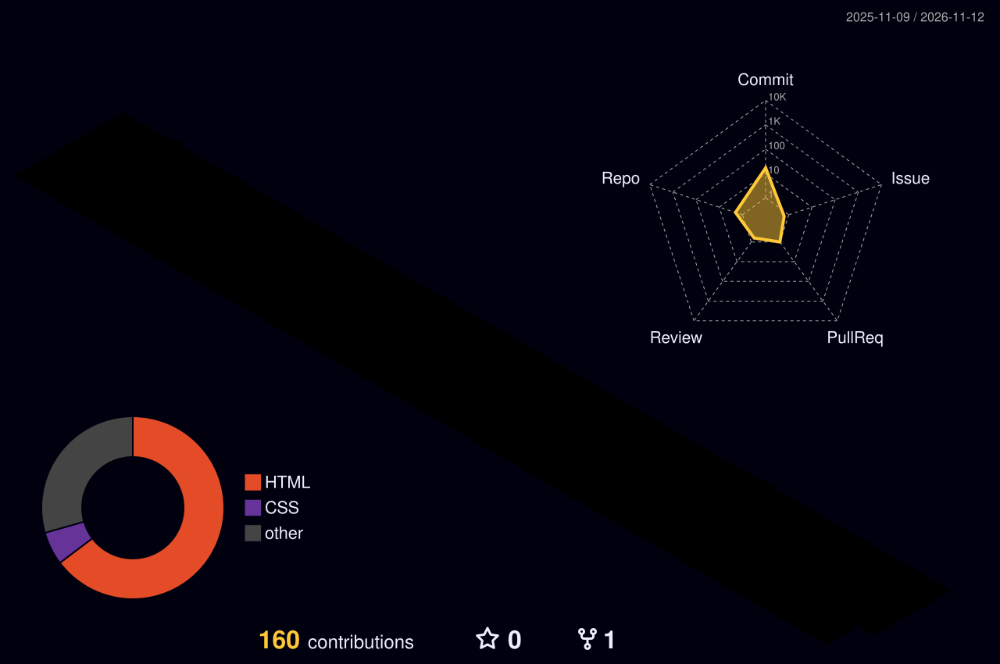

  <!-- Cabeçalho estilo Terminal com digitação animada -->
  

  

    
    
    
  

---

### `>_ whoami`

- **Rickelme Augusto** — Computer Engineering student & builder focused on turning complex problems into clean, scalable software.
- Working with **AI Applications, Software Development, and Software Architecture**.
- Open to connections, project collaborations, and new opportunities via [LinkedIn](https://www.linkedin.com/in/rickelme-augusto-171030430/).

---

### `>_ tech_stack`

  
  
  
  
  

---

### `>_ telemetry`

  
  

---

### `>_ commit_matrix`

  

